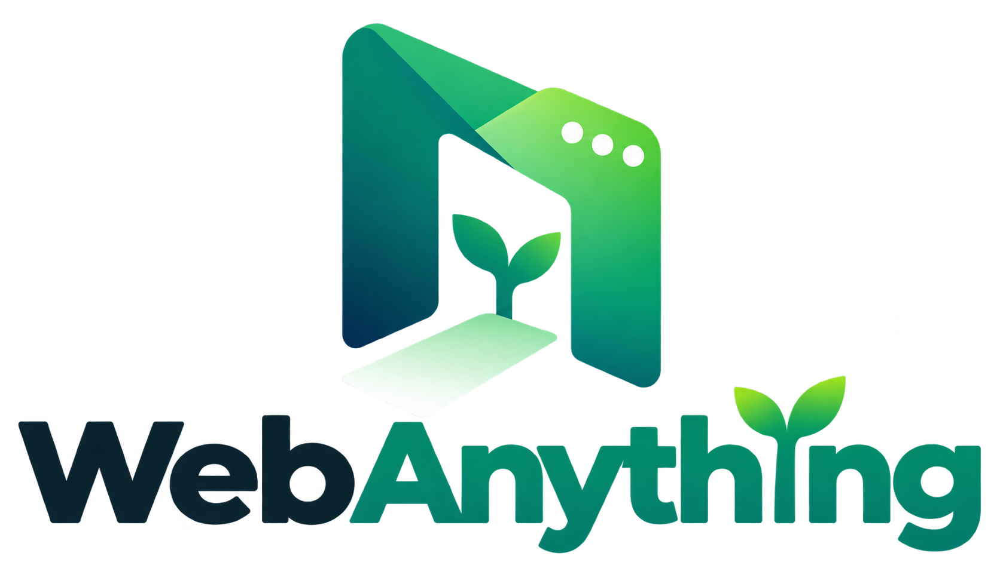
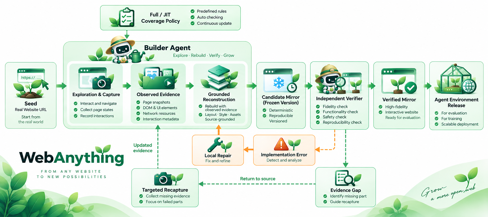
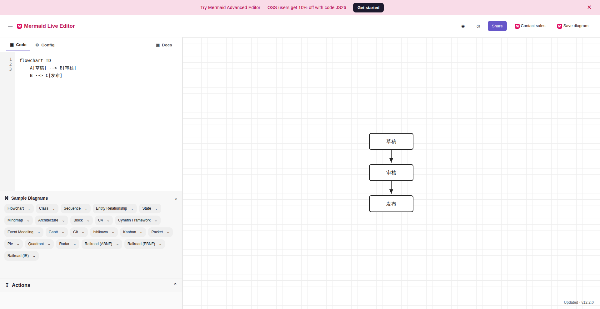

# WebAnything

[English](README.md) | [简体中文](README.zh-CN.md)

[](https://china-qijizhifeng.github.io/Web-Anything/)
[](https://arxiv.org/abs/2610.37786)

<p align="center">
  
</p>

WebAnything 是一个研究代码库，依据源站证据构建可运行、可重置的 Web Agent 环境。本仓库包含构建流水线，以及 244 个历史网站产物的冻结清单。244 个网站的完整源码树和第三方媒体文件仍保存在原有产物库中，未打包进本仓库。

Python 包和命令行入口均名为 `webanything`。新运行使用 `webanything` 的 schema ID、运行时名称和 `WEBANYTHING_*` 模型服务环境变量。已有的冻结运行目录保留原始名称与哈希；继续这些运行时，应使用创建它们的代码版本。

**论文：** [WebAnything: From the Wild Web to Scalable Agent Environments](https://arxiv.org/abs/2610.37786)

## 工作流程概览

[](assets/webanything-workflow-concept.png)

点击图片可查看原尺寸。这是一张概念图；实际实现的流水线和覆盖范围以[架构说明](docs/architecture.md)及[已知限制](docs/limitations.md)为准。

## 快速开始

WebAnything 需要区分两个 URL：供 Builder 和 Verifier 使用的 **兼容 Responses API 的模型接口 URL**，以及需要重建的**源网站 URL**。模型服务必须支持 Responses API 和所选模型 ID。

在仓库根目录安装项目依赖和浏览器：

```bash
uv sync --locked --extra dev --extra browser --extra visual --extra builder
uv run python -m playwright install chromium
npm --prefix tools/codex-mirror-trace ci
```

运行一次 setup。它会提示输入模型接口的基础 URL（通常以 `/v1` 结尾）、服务商使用的模型 ID，以及 API Key；输入 Key 时终端不会显示内容。默认会为 Codex 安装个人 WebAnything 技能：

```bash
uv run webanything setup
```

如需同时为 Codex 和 Claude Code 安装技能，运行 `uv run webanything setup --agent both`。然后新开一个 agent 对话，例如输入：**“重建 https://example.org，让我找到并打开第二个示例。”** 如果希望尽可能覆盖整个站点，则明确要求使用 **Full** 模式。给出具体任务时，技能会选择 JIT 并调用命令行工具。它是本地 agent 技能，并非 MCP 服务；安装后的技能会指向当前代码目录，因此移动仓库后需要重新运行 setup。Agent 需要能访问这台机器的终端。

默认情况下，Key 保存在仓库之外的 `~/.config/webanything/provider.json`，文件仅允许所有者读取；agent 技能文件中不含 Key。CI 或其他自动化场景应通过密钥管理工具设置 `WEBANYTHING_API_URL`、`WEBANYTHING_API_KEY`，以及可选的 `WEBANYTHING_MODEL`。不要把真实 Key 放进命令参数、运行目录或提交到仓库的 `.env` 文件。

也可以直接在命令行中传入**源网站 URL**并选择模式：

```bash
uv run webanything create https://example.org/ --mode full
uv run webanything create https://example.org/ --mode jit --task "Find the second example and open it"
```

`create` 使用 setup 中选定的模型，推理强度默认为 `high`。如果未运行 setup，默认模型 ID 为 `gpt-5.6-sol`；可用 `--model your-model-id` 覆盖，并按需使用 `--reasoning-effort`。`full` 探索可发现的公开路由和控件，并要求独立覆盖检查；`jit` 构建和检查完成指定任务所需的完整交互路径。站点 ID、需求文件和运行目录会自动生成。

运行完成后，`webanything preview <run-dir>` 可在 `http://127.0.0.1:8000/` 本地预览生成的网站。命令会打印运行目录和权威状态；仅能打开页面，并不代表已经通过验证。配置路径、环境变量和运行行为详见[简易接口说明](docs/simple-interface.md)。

如需用容器预览仓库中的一个示例：

```bash
docker build -t webanything .
docker run --rm -p 8000:8000 \
  -e WEBANYTHING_SITE=uswds-docs-demo webanything
```

镜像只启动选定的一个站点。Builder 预览和批量验证共用同一个轻量运行时；只有验证任务需要时，才会启动批量 reset 与健康检查接口。

## 仓库包含的内容

| 路径 | 用途 |
| --- | --- |
| `src/webanything/` | 命令行工具、站点发现、契约、发布、重放与合成模式 |
| `tools/coupled-pipeline/` | 依据源站证据工作的 Builder、独立 Verifier 和修复循环 |
| `tools/codex-mirror-trace/` | 已采集证据和 SDK 轨迹工具 |
| `pipeline-tools/interaction-verifier-v1/` | 候选站点的交互检查 |
| `.agents/skills/build-webharbor-mirrors/` | Builder 指引及配套脚本 |
| `scripts/` | 批量处理、部署和清单工具 |
| `data/sites244.json` | 冻结的产物路径、源站 URL、状态和 `app.py` 哈希清单 |
| `sites/uswds-task-accordion/` | 可运行的 USWDS Accordion 任务驱动重建示例，含字体使用说明 |
| `sites/uswds-docs-demo/` | 两页 USWDS 重建示例，并记录了验证限制 |
| `sites/mermaid-live-task-svg/` | 可运行的 Mermaid 编辑器任务示例：编辑三个节点并导出 SVG；参见[案例研究](docs/case-studies/mermaid-live-editor.md) |
| `tests/` | 单元测试和协议检查 |

本仓库源码整理自现有 WebHarbor 产物库中历史版本 `ac48c8c62377e4724f2fc00c7c5f441aac614103` 的 `public-release/NexGarden` 目录，并包含 [`provenance/source_snapshot.json`](provenance/source_snapshot.json) 明确列出的工作区变更。一份历史项目文档快照保存在 [`docs/WEBANYTHING_UPSTREAM.md`](docs/WEBANYTHING_UPSTREAM.md)，其中的发布状态说明已更新。

## 复现代码并审计清单

需要 Python 3.12、Node.js 18+、`uv` 和 Chromium。在仓库根目录运行：

```bash
uv sync --locked --extra dev --extra browser --extra visual --extra builder
uv run python -m playwright install chromium
npm --prefix tools/codex-mirror-trace ci
uv run webanything doctor --json
uv run pytest tests pipeline-tools/interaction-verifier-v1/tests
npm --prefix tools/codex-mirror-trace test
uv run python scripts/verify_site_inventory.py
```

最后一条命令只验证冻结的 244 站清单，不下载网站内容。若已有原产物库，还可以检查清单中选定站点的入口文件：

```bash
uv run python scripts/verify_site_inventory.py \
  --webharbor-root /path/to/WebHarbor
```

`--webharbor-root` 指向的目录必须包含清单所列的 `sites/` 和 `generated/`。清单再生成、新站点构建及历史证据的解释方法见 [`docs/REPRODUCIBILITY.md`](docs/REPRODUCIBILITY.md)。

## 证据边界

清单从数个历史批次中选出 244 个唯一站点 ID。目录存在且 `app.py` 哈希匹配，可以确认产物身份；HTTP 200 和截图只能证明曾观察到启动或渲染，不能证明各站点通过了统一的功能验收、发布门槛，也不能证明 244 个站点由完全相同版本的流水线构建。2026 年 10 月 9 日的审计对其中 113 个站点做了更深入的检查，另有 131 个仅达到基础观察层级。

## 版权、许可与使用边界

244 站清单是元数据，**不是 244 个重建网站的资源包**。本仓库的 `sites/` 下仅包含三个有限范围的演示站点，并为 Website Wall 收录了经过降采样的首页预览图；没有收录 244 个历史站点的完整源码树、全分辨率截图档案或媒体资源包。预览尺寸和证据边界见 [Website Wall 素材说明](docs/wall-demo/README.md)。

WebAnything 自有代码采用 [MIT License](LICENSE) 发布。项目所有者已于 2026 年 10 月 18 日确认拥有此次发布所需的授权。仓库级 MIT 许可证不替代第三方素材各自适用的条款、声明与署名要求。

第三方网站内容、截图、字体、Logo、名称及商标仍受各自权利人及适用条款约束。仓库内的演示分别附有说明：[USWDS Accordion](sites/uswds-task-accordion/THIRD_PARTY_NOTICES.md)、[Mermaid 编辑器](sites/mermaid-live-task-svg/THIRD_PARTY_NOTICES.md)，以及[两页 USWDS 演示](sites/uswds-docs-demo/README.md)。这些是独立的研究性重建，不代表源项目与 WebAnything 存在关联或背书。

请仅对自己有权检查和重建的网站及内容使用 WebAnything。采集、分享、托管或复用生成站点前，应核查源站条款及其中内容和素材的权利。公开 URL、生成的产物或技术验证通过，本身都不能证明有权再分发源站素材。

## 案例研究：从任务 query 到可用页面

> **任务 query：** 在 Mermaid Live Editor 中，把默认流程图改为「草稿 → 审核 → 发布」，确认预览显示三个节点，然后导出 SVG。

[](docs/case-studies/mermaid-live-editor.md)

用户可以在重建页面中修改图表、核对预览，并通过 **Actions → SVG** 下载文件。[完整案例研究](docs/case-studies/mermaid-live-editor.md)展示了浏览器操作步骤、导出的文件和验证证据，也说明了原运行中 supervisor 的限制。

## 按用户任务重建

使用 `webanything create URL --mode jit --task "..."`。任务运行会记录依据源站观察得到的操作序列，构建完成任务所需的路由与状态，并要求独立浏览器逐步重放通过后，才会报告完成。证据格式和 USWDS 示例见 [`docs/TASK_QUERY.md`](docs/TASK_QUERY.md)。如需手动指定站点 ID、需求文件和运行目录，仍可使用较底层的 `coupled-pipeline` 命令。

## 引用

```bibtex
@article{xie2026webanything,
  title   = {WebAnything: From the Wild Web to Scalable Agent Environments},
  author  = {Xie, Tianci and Cai, Zikun and Zhang, Chaoyun and Guo, Pinxue and Li, Bingxuan and Zheng, Rui and Yan, Hang},
  journal = {arXiv preprint arXiv:2610.37786},
  year    = {2026}
}
```
