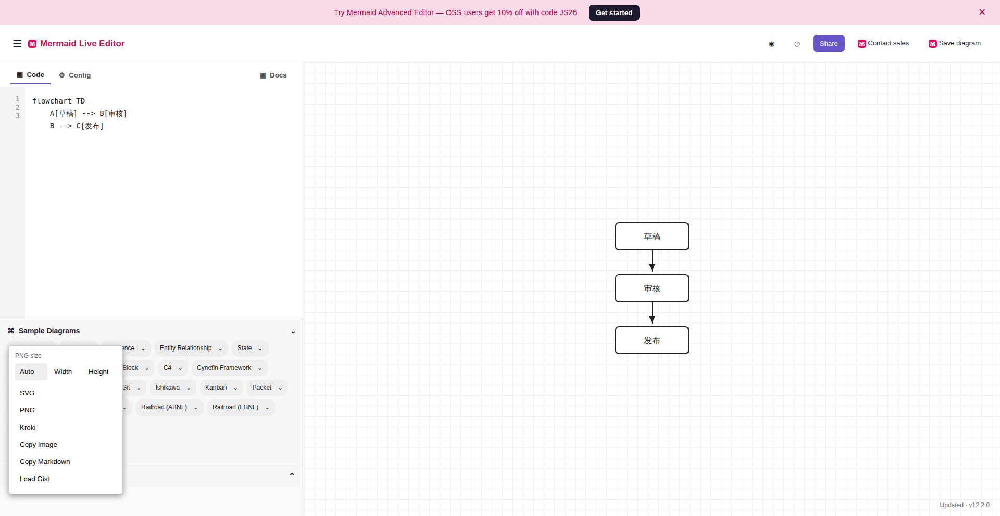
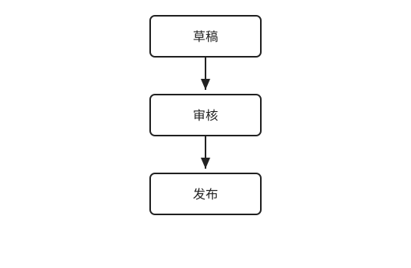

# From a task query to an interactive Mermaid editor

**Case study · JIT reconstruction · Mermaid Live Editor · SVG export**

WebAnything used one public URL and one user task to build a runnable, task-focused reconstruction of [Mermaid Live Editor](https://mermaid.live/). The [local demo](../../sites/mermaid-live-task-svg/) is an independent implementation, not the official editor.

## The exact task query

> **“在 Mermaid Live Editor 中，把默认流程图改为「草稿 → 审核 → 发布」，确认预览显示三个节点，然后导出 SVG。”**

This query defines the required interaction depth. A static picture would not complete it: the user must edit the diagram, see the preview respond, open the export control, and download an SVG.

| Input | Reconstructed task surface | Observable result |
| :--- | :--- | :--- |
| [Mermaid Live Editor](https://mermaid.live/) URL + the query above | Editable code pane, live preview, **Actions → SVG** | Downloaded `mermaid-diagram.svg` with **草稿 → 审核 → 发布** |

## The page we built

The reconstructed editor accepts this diagram text:

```text
flowchart TD
    A[草稿] --> B[审核]
    B --> C[发布]
```

[](evidence/mermaid-live/step-03-edit.png)

*The reconstructed page after editing. The code pane contains the three requested labels; the live preview shows three connected nodes. Click the image to inspect the full-size browser capture.*

## Follow the query through the site

| User goal | What the reconstructed site lets the user do | Browser evidence |
| :--- | :--- | :--- |
| Start from the editor | Open `/`, see the default diagram, and dismiss the first-load dialog with **Stay on mermaid.live**. | [Entry](evidence/mermaid-live/step-01-entry.png) · [Ready to edit](evidence/mermaid-live/step-02-dismiss.png) |
| Make and confirm the change | Replace the code in the editor. The preview updates to exactly three labeled rectangles. | [Edited page and preview](evidence/mermaid-live/step-03-edit.png) |
| Export the result | Expand **Actions**, choose **SVG**, and receive a real file download. | [Export menu](evidence/mermaid-live/step-04-actions.png) · [Downloaded SVG](evidence/mermaid-live/mermaid-diagram.svg) |

### The export control is part of the reconstructed page

[](evidence/mermaid-live/step-04-actions.png)

*The browser replay opened **Actions** and found **SVG**. The next click downloaded the diagram rather than merely showing a success message.*

### The downloaded artifact

[](evidence/mermaid-live/mermaid-diagram.svg)

*The SVG produced in the independent browser replay. It contains one occurrence of each requested label and three node rectangles. [Open the SVG](evidence/mermaid-live/mermaid-diagram.svg) to inspect the file itself.*

## What the browser replay established

The independent Verifier followed all five ordered actions—open, dismiss, edit, expand Actions, and download—and marked each step passed. Its [task contract](evidence/mermaid-live/task-contract.json) defines the expected browser states; the [coverage record](evidence/mermaid-live/task-coverage.json) contains the observed state and evidence path for every step.

| Check | Observed result |
| :--- | :--- |
| Task actions | **5 / 5** passed in the independent browser replay |
| Preview | **3** labeled node rectangles after editing |
| Export | `mermaid-diagram.svg` downloaded; SHA-256 `df3a891faaa8f1caa75b41080571ee7fc4849dea7d9be0891a6a19926432dcee` |
| Visual comparison | `0.96964` for `/` and `/edit` at 1920 × 992, above the `0.95` threshold |
| Additional checks | Resource, overflow, reset, and frozen-candidate integrity checks passed |

> [!IMPORTANT]
> **Run status:** The Verifier's own report passed, but the original supervisor ended at `blocked_retry_limit`. Its task gate incorrectly rejected structured JSON assertions. We fixed the validator and its regression test, then passed the corrected gate against an isolated copy of the fourth Verifier output. This is evidence for the demonstrated task path; it is **not** a fresh end-to-end supervisor pass.

## What is implemented

The demo is a small Flask app in [`sites/mermaid-live-task-svg/app.py`](../../sites/mermaid-live-task-svg/app.py). SQLite holds the current diagram, while `seed.db` supplies repeatable initial state.

| Route | Role in the task |
| :--- | :--- |
| `GET /` and `GET /edit` | Render the editor, preview, and opening dialog. |
| `POST /api/diagram` | Save the edited code and return the updated SVG preview. |
| `GET /export/svg` | Download the current diagram as an SVG attachment. |
| `POST /_reset` | Restore the runtime database byte for byte from `seed.db`. |

The official `/` entry resolved to `/edit` during the independent source check. The local app serves both routes; the browser replay began at `/` and checked `/edit` separately. The implementation covers this observed flowchart path and a small subset of labels and node shapes. Other Mermaid syntax and unrelated controls are outside the task scope.

The frozen candidate tree hash was `1889ba67e99df88970e0302a55467a85facdbec80a3a60f29b60b12013b8b7bc`. The bundled [example output](../../sites/mermaid-live-task-svg/example-output.svg) and app omit the frozen candidate's runtime database and Python cache; user labels are also XML-escaped before SVG insertion. Its file hash therefore differs from the frozen candidate. A later local browser replay again edited the diagram, confirmed the preview, and downloaded SVG; a separate smoke check verified reset and XML escaping.

## Try the reconstructed site

From the repository root:

```bash
uv sync --locked --extra builder
uv run python sites/mermaid-live-task-svg/app.py
```

Open `http://127.0.0.1:5000/`. Dismiss the dialog, enter the three-line flowchart above, inspect the preview, then choose **Actions → SVG**.

To run a new task-driven construction from the live source instead of the bundled demo, [configure a Responses-compatible provider](../../README.md#quick-start) and run:

```bash
webanything create https://mermaid.live/ \
  --mode jit \
  --task '在 Mermaid Live Editor 中，把默认流程图改为「草稿 → 审核 → 发布」，确认预览显示三个节点，然后导出 SVG。' \
  --model gpt-5.6-sol --reasoning-effort high
```

The live source and model responses can change, so a new construction is a separate run. See the [site attribution notes](../../sites/mermaid-live-task-svg/THIRD_PARTY_NOTICES.md) before redistribution.
