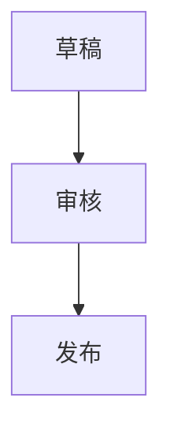

# Mermaid Live Editor SVG task demo

This local reconstruction follows a task observed on the public [Mermaid Live Editor](https://mermaid.live/). It is an independent demo, not the official Mermaid website.

Task query: **在 Mermaid Live Editor 中，把默认流程图改为「草稿 → 审核 → 发布」，确认预览显示三个节点，然后导出 SVG。**

From the repository root, install the project dependencies and start the site:

```bash
uv sync --locked --extra builder
uv run python sites/mermaid-live-task-svg/app.py
```

Open `http://127.0.0.1:5000/`. Dismiss the opening dialog with **Stay on mermaid.live**, replace the editor content with:



Confirm the preview has three nodes, expand **Actions**, and select **SVG**. The downloaded `mermaid-diagram.svg` contains the three labels and three node rectangles. `POST /_reset` restores the seed database.

An [example SVG export](example-output.svg) is included for quick inspection.

This demo implements the observed task path and a small flowchart subset. Other Mermaid syntax and controls are outside its scope. It makes no external runtime requests. Source and asset attribution are in [THIRD_PARTY_NOTICES.md](THIRD_PARTY_NOTICES.md); the five-step replay is documented in the [case study](../../docs/case-studies/mermaid-live-editor.md).
